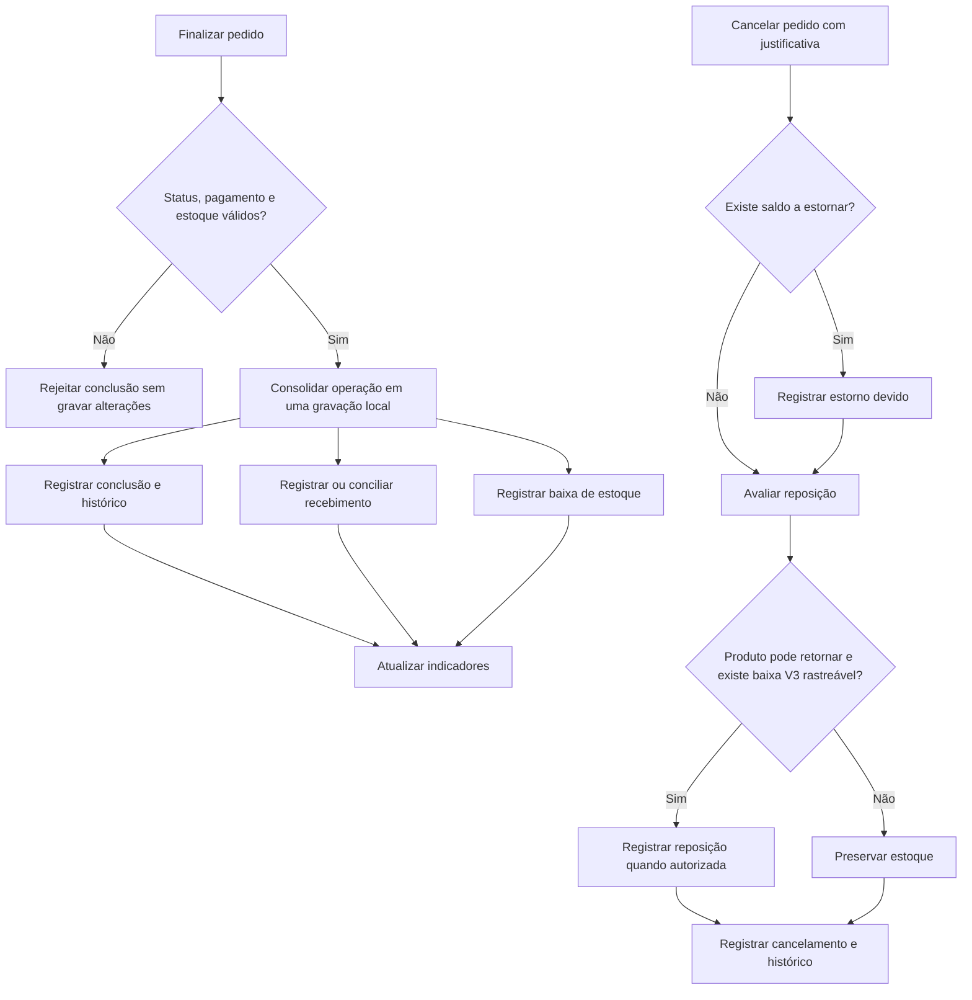

# Documentação técnica — O Gato Preto Café (V3)

[Voltar ao README](README.md) · [Acessar o protótipo](https://ricardo-ls1.github.io/PI/)

Documento complementar ao README, destinado ao acompanhamento técnico e acadêmico do Projeto Integrador. Atualizado com base no diagrama V3, no ZIP da versão 3 e nos registros de revisão que acompanham o código. Não constitui homologação do sistema pela empresa.

## Referências do projeto

- Diagrama Gato Preto Café Revisado (5 páginas): linha de base com 21 casos de uso.
- Diagrama Gato Preto Café V3 (7 páginas): 30 casos de uso, 66 subfunções e 132 operações, incluindo regras de integração.
- Sistema de Gestão do O Gato Preto Café (6 páginas): contexto empresarial e proposta de solução.
- Código-fonte e registro técnico do `gato-preto-cafe-prototipo-v3.zip`.

O logotipo SVG é uma proposta gráfica, não uma reprodução confirmada da marca oficial. Login, tema, responsividade e recursos de interface complementam a modelagem sem alterar a contagem de casos de uso.

## Arquitetura e responsabilidades

A arquitetura é estática, com HTML5, CSS3, JavaScript, SVG e LocalStorage. O GitHub Pages entrega os arquivos; toda a lógica de negócio ocorre no navegador.

| Arquivo | Responsabilidade |
| --- | --- |
| `index.html`, `pages/*.html` | Login e páginas internas. |
| `css/style.css` | Layout, temas, gráficos, responsividade e impressão. |
| `js/dados.js` | Base de demonstração, migração, validação, gravação, integração e históricos. |
| `js/global.js` | Sessão, permissões, navegação, filtros, componentes, gráficos, notificações e pesquisa. |
| `js/login.js` | Entrada, credenciais demonstrativas e restauração. |
| `js/dashboard.js` | Painel geral, filtros e indicadores autorizados. |
| `js/pedidos.js` | Registro, consulta, edição, status, conclusão e cancelamento. |
| `js/estoque.js` | Produtos, entradas, saídas, ajustes e alertas. |
| `js/financeiro.js` | Recebimentos, despesas, quitações, estornos, fluxo de caixa e relatórios. |
| `js/administracao.js` | Usuários, permissões, configurações, backup e atividades. |
| `assets/logo.svg` | Identidade gráfica do protótipo. |

## Matriz de rastreabilidade

Cada linha identifica um caso de uso. Cada subfunção está em negrito, seguida de suas duas operações internas, separadas por `/`. A matriz corresponde à modelagem V3 e aos pontos de implementação identificados no ZIP; não equivale a 132 testes independentes.

### Pedidos

| ID / Caso de uso | Subfunções e operações | Implementação |
| --- | --- | --- |
| P01 Registrar pedido | **Montar pedido:** selecionar produtos / informar quantidades. **Concluir registro:** verificar disponibilidade / calcular total e salvar. | Pedidos → Registrar pedido; `pedidos.js` |
| P02 Consultar pedidos | **Localizar pedidos:** pesquisar por número / filtrar por data ou status. **Examinar pedido:** ver itens e quantidades / consultar valor e situação. | Consultar pedidos e Ver pedido |
| P03 Atualizar status | **Validar alteração:** localizar pedido / verificar transição permitida. **Registrar mudança:** selecionar novo status / salvar data da atualização. **Encaminhar conclusão:** acionar Finalizar pedido / manter histórico da transição. | Atualizar status, ações rápidas, `mudarStatus`, `finalizarUI` |
| P04 Cancelar pedido | **Verificar cancelamento:** localizar pedido / conferir situação atual. **Efetivar cancelamento:** informar motivo / registrar status cancelado. **Tratar consequências:** verificar pagamento e estornar se devido / avaliar devolução e registrar se cabível. | Cancelar pedido e ação rápida; `Dados.cancelar` |
| P05 Consultar histórico de pedidos | **Pesquisar registros:** selecionar período / filtrar por situação. **Consultar eventos:** ver criação e alterações / ver datas de cancelamento. | Histórico de pedidos; Ver histórico |
| P06 Editar pedido | **Alterar composição:** adicionar ou remover produtos / alterar quantidades. **Validar alterações:** verificar disponibilidade / recalcular total e salvar. | Ação Editar, `editarUI`, `Dados.validarItens` |
| P07 Finalizar pedido | **Validar finalização:** conferir situação e estoque / impedir conclusão e lançamentos duplicados. **Confirmar pagamento:** selecionar forma / confirmar recebimento. **Consolidar operação:** registrar conclusão, data e responsável / integrar saída e recebimento. | Ação Finalizar; `finalizarUI`, `Dados.finalizar` |

### Estoque

| ID / Caso de uso | Subfunções e operações | Implementação |
| --- | --- | --- |
| E01 Cadastrar produtos | **Identificar produto:** nome e categoria / unidade e descrição. **Definir parâmetros:** preço de venda / saldo inicial e mínimo. | Estoque → Cadastrar produtos |
| E02 Consultar estoque | **Pesquisar produtos:** buscar nome / filtrar categoria. **Verificar disponibilidade:** consultar quantidade atual / consultar preço e unidade. | Consultar estoque |
| E03 Registrar entrada | **Identificar item:** pesquisar produto / conferir cadastro. **Registrar entrada:** informar quantidade e data / atualizar saldo e histórico. | Registrar entrada |
| E04 Registrar saída | **Validar retirada:** selecionar produto / conferir saldo. **Registrar saída:** informar quantidade e motivo / atualizar saldo e histórico. **Integrar pedido:** identificar pedido e itens / impedir baixa duplicada ou saldo negativo. | Registrar saída, `Dados.finalizar` |
| E05 Ajustar estoque | **Conferir divergência:** consultar saldo / informar quantidade apurada. **Aplicar correção:** registrar justificativa / atualizar saldo e histórico. | Ajustar estoque |
| E06 Consultar produtos com estoque baixo | **Detectar nível baixo:** comparar saldo ao mínimo / identificar itens abaixo. **Consultar alertas:** listar críticos / filtrar categoria. | Estoque baixo, notificações |
| E07 Gerenciar produtos cadastrados | **Editar produto:** alterar dados / atualizar preço e mínimo. **Controlar disponibilidade:** ativar/inativar / preservar histórico. | Gerenciar produtos, ação Editar |

### Financeiro

| ID / Caso de uso | Subfunções e operações | Implementação |
| --- | --- | --- |
| F01 Registrar recebimentos | **Identificar origem:** vincular pedido quando houver / selecionar forma. **Registrar entrada:** informar valor e data / salvar no caixa. **Integrar venda:** receber dados do pedido pago / impedir lançamento duplicado. | Financeiro → Registrar recebimentos, `Dados.finalizar` |
| F02 Registrar despesas | **Caracterizar despesa:** informar descrição / selecionar categoria. **Lançar despesa:** informar valor e data / definir situação. | Registrar despesas |
| F03 Consultar receitas | **Pesquisar recebimentos:** filtrar período / filtrar forma. **Consolidar receitas:** exibir lançamentos / calcular total recebido. | Consultar receitas |
| F04 Consultar despesas | **Pesquisar despesas:** filtrar período / filtrar categoria. **Consolidar despesas:** exibir lançamentos / calcular total de despesas. | Consultar despesas |
| F05 Consultar fluxo de caixa | **Apurar movimentações:** somar recebimentos / somar despesas. **Apresentar saldo:** calcular saldo do período / exibir evolução por data. | Fluxo de caixa, `caixa`, `financialSeries` |
| F06 Gerar relatórios financeiros | **Definir relatório:** escolher tipo / selecionar período. **Preparar relatório:** consolidar dados e totais / visualizar ou exportar. | Relatórios financeiros, CSV, `imprimirRelatorio` |
| F07 Consultar histórico financeiro | **Pesquisar lançamentos:** selecionar período / filtrar entrada ou saída (e estorno). **Examinar registros:** consultar origem e valor / consultar data de registro. | Histórico financeiro |
| F08 Quitar despesas pendentes | **Identificar despesa:** localizar lançamento / conferir situação. **Registrar pagamento:** informar data e forma / atualizar caixa. | Quitar despesas, `Dados.quitar` |
| F09 Registrar estornos | **Identificar recebimento:** localizar pagamento original / verificar estornos anteriores. **Efetivar estorno:** registrar valor e justificativa / atualizar saldo e histórico. | Registrar estornos, `Dados.estornar` |

### Administração

| ID / Caso de uso | Subfunções e operações | Implementação |
| --- | --- | --- |
| A01 Cadastrar usuários | **Identificar usuário:** nome e login / credenciais iniciais. **Atribuir acesso:** selecionar perfil / ativar conta. | Administração → Cadastrar usuários |
| A02 Gerenciar usuários e permissões | **Manter contas:** editar dados / ativar/inativar. **Administrar permissões:** alterar perfil / revisar acessos. **Personalizar acessos:** permitir/bloquear módulos / preservar acesso administrativo e aplicar restrições. | Gerenciar usuários e permissões, `allowed`, `iniciarPagina` |
| A03 Configurar sistema | **Ajustar operação:** atualizar dados do café / definir formas de pagamento. **Gerenciar configurações:** revisar parâmetros / salvar alterações. | Configurar sistema |
| A04 Gerenciar backup e restauração | **Exportar dados:** consolidar registros / gerar JSON. **Restaurar dados:** validar arquivo / recuperar registros com confirmação. | Backup e restauração, `Dados.validar` |
| A05 Consultar histórico de atividades | **Pesquisar atividades:** filtrar usuário / filtrar período ou módulo. **Examinar operações:** identificar ação / consultar data, horário e responsável. | Histórico de atividades, `Dados.atualizar` |

### Funcionalidades transversais

| ID / Caso de uso | Subfunções e operações | Implementação |
| --- | --- | --- |
| T01 Consultar dashboards gerenciais | **Analisar indicadores:** selecionar período / comparar resultados. **Explorar gráficos:** consultar valores detalhados / interagir com séries e legendas. | Dashboard geral e dos módulos, `quickPeriodMetrics`, `chartView` |
| T02 Consultar notificações | **Identificar ocorrências:** verificar estoque baixo e pedidos pendentes / identificar despesas pendentes. **Gerenciar alertas:** consultar detalhes / marcar como lidas. | Central de notificações, `alertas`, `notificationsUI` |

**Total:** 30 casos de uso, 66 subfunções e 132 operações (Pedidos: 7/17/34; Estoque: 7/15/30; Financeiro: 9/19/38; Administração: 5/11/22; Transversais: 2/4/8).

## Integração e relacionamentos UML

O diagrama V3 (página 7) estabelece `«include»` de Finalizar pedido para Registrar recebimentos e Registrar saída de produtos. Registrar estornos estende Cancelar pedido (`«extend»`) quando existe pagamento a estornar. Confirmar pagamento é uma subfunção de Finalizar pedido, não um caso de uso adicional.

## Regras de negócio

As quatro primeiras regras seguem a página 7 do diagrama V3. As demais detalham decisões de implementação documentadas no ZIP.

**RN01 — Consistência.** Somente concluir pedido válido com pagamento confirmado e estoque suficiente. `Dados.finalizar` revalida status, quantidades, produtos ativos e disponibilidade. Pedido, recebimento, baixa e históricos são persistidos em uma atualização do objeto local; falha antes da gravação preserva o estado anterior. Não há reserva de estoque ao registrar o pedido nem garantia de transações concorrentes entre abas.

**RN02 — Sem duplicidade.** Cada venda é identificada pelo pedido. Não repetir a conclusão, a receita ou a baixa. Um recebimento manual vinculado, íntegro, com valor total e forma coincidentes pode ser conciliado na conclusão; divergências, múltiplos recebimentos ou estornos anteriores exigem conferência. Lançamentos manuais sem vínculo continuam disponíveis.

**RN03 — Cancelamento e estorno.** Cancelamentos exigem justificativa e podem ocorrer após a conclusão. Estornar somente o saldo ainda devido dos recebimentos associados. A reposição é opcional e limitada às baixas automáticas V3 rastreáveis e aos produtos que efetivamente possam retornar. Estorno manual não altera automaticamente a situação do pedido nem recompõe estoque. O histórico é preservado.

**RN04 — Acesso.** Administração é exclusiva do perfil Administrador. Os módulos operacionais são configuráveis por conta, sem permitir a perda do próprio acesso administrativo. Menu, dashboards, notificações e pesquisa respeitam as permissões. A integração interna de um pedido autorizado pode gerar registros em módulos restritos, sem conceder acesso à interface. As restrições são simuladas.

**RN05 — Pedidos.** Estados: Pendente, Em preparo, Pronto, Concluído e Cancelado. Avanços diretos são permitidos; a conclusão sempre utiliza a rotina integrada. Pedidos não pagos permanecem em andamento. A edição é restrita a pedidos em andamento e o preço histórico dos itens é preservado. Não há pagamento dividido ou parcelado nem processamento real.

**RN06 — Estoque.** A baixa corresponde à quantidade de produtos vendidos, não a ingredientes. Produtos inativos não entram em novos pedidos. O saldo não pode ficar negativo. Pedidos utilizam quantidades inteiras, enquanto movimentações admitem até três casas decimais. Alerta de estoque baixo: produto ativo com saldo estritamente inferior ao mínimo.

**RN07 — Financeiro.** Valores em BRL. Receitas líquidas incluem estornos como lançamentos negativos. Despesas pendentes não afetam o caixa; a quitação utiliza a data efetiva de pagamento, preservando a data original. Saldo do período = receitas líquidas − despesas pagas, sem saldo anterior. Estornos não movimentam dinheiro real.

**RN08 — Indicadores.** Pedidos são filtrados pela data de registro; o ticket médio considera pedidos concluídos no período. Estoque apresenta a posição corrente, não uma reconstrução histórica. O faturamento recebido bruto considera os recebimentos positivos, inclusive manuais; o gráfico de formas de pagamento é bruto, sem deduzir estornos. Comparações utilizam período anterior de mesma duração e não inventam percentuais quando a base é zero.

**RN09 — Migração.** A chave `gato-preto-cafe-v1` permanece a mesma. A migração preserva as coleções anteriores e acrescenta campos padrão. Pedidos concluídos antigos são identificados como legado e não geram receita ou baixa retroativa; divergências anteriores exigem conciliação manual. A migração não inventa responsáveis por operações antigas.

**RN10 — Backup e restauração.** Importações validadas e confirmadas substituem a base local e encerram a sessão. A validação verifica estrutura, identificadores, referências básicas, estornos e presença de administrador ativo; não constitui auditoria contábil. A restauração dos dados fictícios é destrutiva para os registros locais.

## Indicadores, filtros e relatórios

- Os dashboards usam dados locais e respeitam as permissões. Filtros rápidos contemplam hoje, ontem, últimos 7 ou 30 dias, mês atual, mês anterior e período personalizado; a preferência é mantida por usuário e página.
- Gráficos nativos de pizza, rosca, linha, área e barras horizontais/verticais utilizam SVG e CSS. Tooltips, foco, toque e legendas interativas permitem consultar detalhes e alternar séries.
- A posição de estoque é corrente. O ranking de vendas considera pedidos concluídos e os gráficos de movimentação contam registros por tipo, evitando somar unidades incompatíveis.
- Campos de data utilizam digitação brasileira e calendário nativo. Lançamentos sugerem a data atual; filtros podem iniciar vazios ou recuperar a preferência. Períodos inválidos são rejeitados.
- O CSV permite análise em planilhas, sem integração automática com Excel. O PDF é gerado via impressão nativa, com layout A4, logotipo, indicadores, gráficos, tabelas e numeração. A apresentação depende do navegador e das opções de impressão.
- A tela cheia possui alternativa de layout quando a API não está disponível. Controles remotos e televisores antigos exigem validação no próprio dispositivo.

## Backup e recuperação

1. Acesse Administração → Backup e restauração.
2. Exporte o backup JSON e mantenha uma cópia local identificada pela data.
3. Para recuperar dados, selecione o JSON, confirme a substituição e entre novamente no sistema.
4. Utilize Restaurar dados de demonstração somente se desejar substituir os registros pelos dados iniciais.

O arquivo inclui versão, data, registros, usuários, credenciais demonstrativas, permissões, configurações, históricos e marcações de notificações. Tema e filtros são preferências locais e não fazem parte do backup operacional. Não utilize dados reais. A base é compartilhada apenas por páginas da mesma origem no mesmo navegador; dados não acompanham a conta GitHub ou a publicação.

## Verificações registradas na V3

Os resultados abaixo foram extraídos do registro técnico entregue com o ZIP V3. Não são uma nova execução de testes realizada na atualização destes arquivos. O ambiente original bloqueou navegação direta HTTP/HTTPS; os testes de interface utilizaram Chromium com HTML, CSS e scripts carregados diretamente e armazenamento simulado, transferindo o estado entre telas. O teste de migração utilizou a implementação de dados do ZIP V2.

| ID | Cenário / entrada | Resultado esperado | Resultado registrado |
| --- | --- | --- | --- |
| CT01 | Login e tema | Preencher credenciais, mostrar senha e alternar tema. | Controles exercitados. |
| CT02 | Pedido de R$ 16,00; estoque inicial de 10; quantidade 2 | Concluir, baixar 2 unidades e registrar uma receita. | Estoque 10 → 8; receita R$ 16,00. |
| CT03 | Repetir conclusão do mesmo pedido | Rejeitar sem alterar registros. | Segunda conclusão rejeitada. |
| CT04 | Pagamento não confirmado ou forma inválida | Não concluir nem gravar movimentações. | Rejeitados sem gravação. |
| CT05 | Estoque insuficiente | Preservar pedido, receitas e movimentos. | Registros preservados. |
| CT06 | Cancelar pedido pago e autorizar reposição | Estornar e recompor estoque elegível. | Estorno integral e reposição registrados. |
| CT07 | Estorno parcial e valor excedente | Aceitar saldo válido; rejeitar excedente. | Parcial aceito; excedente rejeitado. |
| CT08 | Editar pedido em andamento | Alterar itens e recalcular. | Quantidade, remoção e recálculo exercitados. |
| CT09 | Cadastrar, editar e inativar produto | Persistir cadastro; impedir novas vendas do inativo. | Operações exercitadas; produto excluído da seleção de novos pedidos. |
| CT10 | Quitar despesa pendente | Alterar situação e contabilizar pagamento. | Quitação registrada. |
| CT11 | Bloquear Estoque para gerente | Restringir acesso, menu, dashboard e alertas. | Restrições verificadas no ambiente simulado. |
| CT12 | Exportar/importar JSON; arquivo inválido | Recuperar registros válidos e rejeitar inválidos. | Exportação, validação, importação e rejeição exercitadas. |
| CT13 | Dashboard com filtro, tooltip e legenda | Atualizar e explorar informações. | Filtro, tooltip, legenda e preferência de período exercitados. |
| CT14 | Notificações e pesquisa global | Marcar alerta como lido e consultar registros autorizados. | Marcação e pesquisa exercitadas. |
| CT15 | Migrar V2 e conciliar recebimento manual | Preservar registros e evitar duplicação. | Registros e saldos preservados; legado identificado; receita não duplicada. |
| CT16 | Simular falha de quota de armazenamento | Preservar estado persistido. | Estado preservado. |
| CT17 | Exportar CSV e imprimir fluxo de caixa | Gerar saída e relatório A4 legível. | Download CSV registrado; PDF de duas páginas inspecionado. |
| CT18 | Abrir seis páginas em nove resoluções | Sem transbordamento horizontal global no estado inicial. | Verificação registrada para todas as seis páginas. |

Resoluções verificadas: 320 × 568, 360 × 800, 390 × 844, 768 × 1024, 1024 × 768, 1366 × 768, 1920 × 1080, 2560 × 1440 e 3840 × 2160. Os conjuntos de testes descritos no registro técnico não apresentaram erros JavaScript após correções. A matriz de rastreabilidade não equivale a um teste separado de cada operação.

### Validações pendentes

- Homologação da navegação real no endereço definitivo e da persistência nativa entre páginas e abas.
- Verificação do download CSV, importação e exportação no navegador publicado.
- Testes em Firefox, outros navegadores, Smart TVs físicas, controles remotos e calendário nativo.
- Inspeção de todos os estados de formulários, modais, temas, relatórios extensos e acessibilidade.
- Validação das regras de negócio e da experiência de uso com os proprietários do estabelecimento.

## Histórico de versões

| Versão | Modelagem e evolução |
| --- | --- |
| V1 | Base navegável dos quatro módulos. |
| V2 | 21 casos de uso; dashboards, relatórios, permissões e responsividade ampliados. |
| V3 | 30 casos de uso; integração, estornos, edição, quitação, backups, atividades, notificações e gráficos interativos. |

## Segurança e escopo

O protótipo não possui autenticação segura, API, banco centralizado, sincronização, auditoria imutável ou comunicação automática com WhatsApp e Excel. As credenciais e os dados podem ser inspecionados ou alterados no navegador. Não há emissão fiscal, gestão de fornecedores, fichas técnicas, controle de validade ou integração real com pagamentos. Utilize exclusivamente dados fictícios. As regras e resultados são demonstrativos, sujeitos à validação empresarial.
