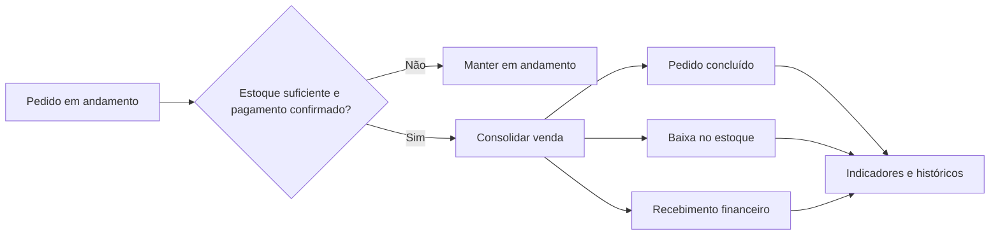

# O Gato Preto Café — Sistema de Gestão

**Projeto Integrador (PI) | Análise e Desenvolvimento de Sistemas | FATEC Guaratinguetá**

    

Protótipo web de um sistema de gestão interno para proprietários e gerentes do O Gato Preto Café, com integração entre pedidos, estoque, financeiro e administração, além de painéis gerenciais interativos.

**[Acessar o protótipo online](https://ricardo-ls1.github.io/PI/)** · **[Documentação técnica](DOCUMENTACAO.md)**

> Projeto acadêmico em fase de prototipação. Os registros e as credenciais de demonstração são fictícios. O sistema não deve ser utilizado para operações reais.

## Sumário

- [Contextualização](#contextualização)
- [Problemática](#problemática)
- [Solução proposta](#solução-proposta)
- [Objetivos](#objetivos)
- [Funcionalidades](#funcionalidades)
- [Perfis de acesso](#perfis-de-acesso)
- [Tecnologias utilizadas](#tecnologias-utilizadas)
- [Estrutura do projeto](#estrutura-do-projeto)
- [Execução local](#execução-local)
- [Relatórios gerenciais](#relatórios-gerenciais)
- [Backup e recuperação](#backup-e-recuperação)
- [Modelagem e documentação](#modelagem-e-documentação)
- [Evolução do protótipo](#evolução-do-protótipo)
- [Testes e validação](#testes-e-validação)
- [Limitações e melhorias futuras](#limitações-e-melhorias-futuras)
- [Equipe](#equipe)

## Contextualização

O projeto foi desenvolvido no contexto da disciplina de Projeto Integrador do curso de Análise e Desenvolvimento de Sistemas da FATEC Guaratinguetá, tendo como empresa parceira o O Gato Preto Café, estabelecimento localizado em Guaratinguetá (SP).

A proposta relaciona os conhecimentos de levantamento de requisitos, modelagem de sistemas, lógica de programação e desenvolvimento web a uma necessidade identificada no ambiente empresarial.

## Problemática

Durante o levantamento inicial, foram identificados controles realizados por meio de planilhas e pedidos organizados pelo WhatsApp. A distribuição de informações entre diferentes ferramentas dificulta a consulta centralizada de dados e o acompanhamento das operações.

O projeto busca atender à necessidade de organizar os registros de pedidos, acompanhar os níveis de estoque e facilitar a análise das receitas e despesas do estabelecimento.

## Solução proposta

A solução consiste em um protótipo navegável de um sistema de gestão web de uso interno, destinado aos proprietários e gerentes. A interface reúne operações administrativas e gerenciais em um único ambiente, com indicadores, filtros, históricos e relatórios.

Na V3, a conclusão de um pedido com pagamento confirmado integra automaticamente a baixa de estoque e o registro de recebimento. A solução simula os processos de negócio no próprio navegador, permitindo avaliar a organização das funcionalidades e a experiência de uso antes de uma eventual implementação com servidor e banco de dados.

## Objetivos

### Objetivo geral

Propor um sistema de gestão que centralize as informações operacionais e financeiras do estabelecimento, apoiando a organização das atividades e a tomada de decisões.

### Objetivos específicos

- Organizar o registro e o acompanhamento dos pedidos.
- Facilitar o controle de produtos e das movimentações de estoque.
- Automatizar as movimentações de estoque e os recebimentos associados à conclusão de pedidos.
- Registrar receitas, despesas, quitações e estornos, acompanhando o fluxo de caixa.
- Apresentar informações gerenciais por meio de indicadores e gráficos.
- Diferenciar os perfis de acesso de administrador e gerente.
- Representar, em uma interface navegável, os requisitos identificados na modelagem do projeto.

## Funcionalidades

| Área | Principais recursos |
| --- | --- |
| Dashboard gerencial | Painel geral e painéis por módulo; indicadores comparativos; filtros rápidos; gráficos interativos de pizza, rosca, linha, área e barras; tela cheia. |
| Pedidos | Cadastro, consulta, edição em andamento, ações rápidas, confirmação de pagamento, conclusão integrada, cancelamento e histórico. |
| Estoque | Cadastro, edição e inativação de produtos; entradas, saídas e ajustes manuais; baixa automática nas vendas; alertas de estoque baixo e histórico. |
| Financeiro | Recebimentos manuais e automáticos, despesas, quitação, estornos parciais ou integrais, fluxo de caixa, históricos e relatórios PDF/CSV. |
| Administração | Usuários, permissões por módulo, configurações do café, backup e restauração em JSON, histórico de atividades. |
| Funcionalidades transversais | Dashboards, notificações com marcação de leitura e pesquisa global conforme os acessos autorizados. |

A interface utiliza azul-claro em degradê, tema escuro persistente, tela de login reformulada, menu recolhível, campos de data em formato brasileiro, tabelas com ordenação e paginação nas consultas e layout adaptável a diferentes tamanhos de tela.

### Integração operacional



A finalização valida a disponibilidade e evita lançamentos duplicados. As alterações são persistidas em conjunto no navegador. Cancelamentos podem gerar estornos e reposição de estoque, quando cabível, sem eliminar o histórico. Os lançamentos manuais continuam disponíveis.

As regras detalhadas estão na [documentação técnica](DOCUMENTACAO.md#regras-de-negócio).

## Perfis de acesso

| Funcionalidade | Administrador | Gerente |
| --- | :---: | :---: |
| Dashboard | Sim | Sim |
| Pedidos | Sim | Sim |
| Estoque | Sim | Sim |
| Financeiro | Sim | Sim |
| Administração | Sim | Não |

A tabela representa os acessos padrão. Um administrador pode personalizar o acesso aos módulos operacionais por conta. O dashboard, o menu, as notificações e a pesquisa global respeitam as permissões simuladas. As rotinas internas de integração de um pedido autorizado não concedem acesso à interface dos demais módulos.

### Credenciais de demonstração

| Perfil | Usuário | Senha inicial |
| --- | --- | --- |
| Administrador | `admin` | `admin123` |
| Gerente | `gerente` | `gerente123` |

As credenciais são públicas e fictícias. O controle de acesso é executado no front-end e não constitui um mecanismo de segurança para uso em produção.

## Tecnologias utilizadas

| Tecnologia | Aplicação |
| --- | --- |
| HTML5 | Estrutura das páginas e formulários |
| CSS3 | Estilização, responsividade e temas |
| JavaScript | Lógica de negócio simulada, validações e interatividade |
| LocalStorage | Persistência de dados e preferências no navegador |
| SVG e CSS | Gráficos interativos e recursos visuais |
| Git e GitHub | Versionamento e organização do código |
| GitHub Pages | Publicação estática do protótipo |

O projeto utiliza tecnologias nativas do navegador, sem dependências externas de execução, frameworks ou servidor de aplicação.

## Estrutura do projeto

```text
PI/
├── index.html
├── pages/
│   ├── dashboard.html
│   ├── pedidos.html
│   ├── estoque.html
│   ├── financeiro.html
│   └── administracao.html
├── css/
│   └── style.css
├── js/
│   ├── global.js
│   ├── dados.js
│   ├── login.js
│   ├── dashboard.js
│   ├── pedidos.js
│   ├── estoque.js
│   ├── financeiro.js
│   └── administracao.js
├── assets/
│   └── logo.svg
├── DOCUMENTACAO.md
└── README.md
```

A aplicação funciona como um conjunto de páginas estáticas. A lógica de manipulação dos registros e as preferências são executadas no navegador; não existe uma API de back-end nem um banco de dados centralizado nesta versão. O repositório inclui um arquivo adicional de documentação técnica, separado do README.

## Execução local

É possível acessar o sistema pelo GitHub Pages ou executar uma cópia localmente. Para a execução local, recomenda-se servir os arquivos por HTTP, evitando diferenças no tratamento do armazenamento entre páginas abertas pelo protocolo `file://`.

Clone o repositório:

```bash
git clone https://github.com/Ricardo-LS1/PI.git
cd PI
```

Com o Python 3 instalado, inicie um servidor estático:

```bash
python3 -m http.server 8000
```

Acesse [http://localhost:8000/](http://localhost:8000/) e utilize uma das contas de demonstração. O Python é necessário apenas para esse método de execução local, não para utilizar o sistema publicado.

Para publicar uma atualização, envie os arquivos do protótipo à raiz do repositório e mantenha a origem do site. Em **Settings → Pages**, configure a publicação pela branch `main`, pasta `/ (root)`, caso ainda não esteja configurada. Não é necessário servidor de aplicação.

## Relatórios gerenciais

No módulo Financeiro, a área **Relatórios financeiros** permite selecionar o tipo de relatório e o período desejado. Os registros podem ser exportados em CSV ou apresentados em um documento para impressão.

Para gerar um PDF, selecione **Imprimir / salvar PDF** e escolha a opção de salvar como PDF na janela do navegador, preferencialmente em papel A4. O documento inclui informações consolidadas, indicadores, gráfico e tabelas. A paginação depende das configurações do navegador.

## Backup e recuperação

No módulo **Administração**, acesse **Backup e restauração** para exportar os registros em JSON ou importar uma cópia existente. A importação valida a estrutura do arquivo e exige confirmação antes de substituir a base local; após a restauração, será necessário entrar novamente.

A opção **Restaurar dados de demonstração** substitui os registros do navegador pelos dados fictícios iniciais. Exporte um backup antes de executar essa ação ou limpar os dados do navegador. Os backups podem conter credenciais demonstrativas; não utilize nem compartilhe dados reais.

## Modelagem e documentação

O desenvolvimento do protótipo tem como referência os materiais acadêmicos produzidos pelo grupo:

- **Diagrama Gato Preto Café Revisado (5 páginas):** modelagem original com 21 casos de uso.
- **Diagrama Gato Preto Café V3 (7 páginas):** ampliação funcional e relacionamentos entre os módulos.
- **Sistema de Gestão do O Gato Preto Café (6 páginas):** contextualização empresarial e proposta de solução.

A modelagem V3 contempla **2 atores, 4 módulos, 30 casos de uso, 66 subfunções e 132 operações internas**. Dois casos de uso transversais abrangem dashboards e notificações.

| Área | Casos de uso | Subfunções | Operações |
| --- | ---: | ---: | ---: |
| Pedidos | 7 | 17 | 34 |
| Estoque | 7 | 15 | 30 |
| Financeiro | 9 | 19 | 38 |
| Administração | 5 | 11 | 22 |
| Transversais | 2 | 4 | 8 |
| **Total** | **30** | **66** | **132** |

A [documentação técnica](DOCUMENTACAO.md) apresenta a matriz de rastreabilidade, as regras de negócio, a arquitetura e os testes registrados. A proposta permanece sujeita à validação com a empresa.

## Evolução do protótipo

| Versão | Descrição |
| --- | --- |
| V1 | Primeira versão navegável, com os quatro módulos, cadastros, consultas e dados fictícios. |
| V2 | Ampliação dos dashboards, gráficos, relatórios, permissões individuais, filtros e responsividade. |
| **V3 (atual)** | Integração automática das vendas, edição de pedidos e produtos, estornos, quitação de despesas, backup JSON, histórico de atividades, notificações, gráficos interativos e refinamento da interface. |

A V3 mantém a chave de armazenamento local da versão anterior. Os registros existentes são preservados na mesma origem e navegador, com adaptação dos campos novos; vendas antigas não geram movimentações retroativas. Exporte um backup antes de restaurar ou substituir a base local.

## Testes e validação

Conforme os registros técnicos da V3, foram realizados testes de sintaxe, finalização integrada, prevenção de duplicidade, estoque insuficiente, cancelamento, estornos, quitação, edição, permissões, backup, gráficos e migração. As seis páginas foram verificadas em nove resoluções, de 320 × 568 a 3840 × 2160, quanto ao transbordamento horizontal nos estados iniciais. Um relatório de fluxo de caixa A4 de duas páginas foi inspecionado visualmente.

As verificações de interface ocorreram em Chromium, com carregamento direto e armazenamento simulado devido às restrições do ambiente original. Não equivalem à homologação da versão publicada, à inspeção de todos os estados de interface ou à validação em Smart TVs físicas.

Consulte os cenários, resultados registrados e limitações em [DOCUMENTACAO.md](DOCUMENTACAO.md).

## Limitações e melhorias futuras

### Limitações atuais

- Dados locais, sem sincronização entre dispositivos ou garantia de concorrência entre abas.
- Autenticação, permissões e pagamentos simulados, sem proteção de produção ou processamento real de pagamentos.
- Baixa por unidade de produto vendido, sem fichas técnicas de ingredientes ou controle de validade.
- Ausência de integração automática com WhatsApp, Excel e serviços financeiros.
- Relatórios PDF dependem da impressão do navegador; compatibilidade com Smart TVs depende do aparelho.
- Regras de negócio sujeitas à validação com a empresa.

### Possíveis melhorias

- Implementação de back-end, banco de dados centralizado e autenticação segura.
- Transações concorrentes, auditoria protegida e políticas de backup no servidor.
- Testes automatizados de regressão e validação de acessibilidade e usabilidade com os usuários do estabelecimento.
- Eventual integração com canais de pedidos, meios de pagamento ou controle de insumos, mediante novo levantamento de requisitos.

Esses itens representam possibilidades de evolução, não funcionalidades já implementadas ou compromissos de entrega.

## Equipe

Projeto desenvolvido por Ricardo, Luiz e Matheus, integrantes do Projeto Integrador.

**Instituição:** FATEC Guaratinguetá — Centro Paula Souza  
**Curso:** Análise e Desenvolvimento de Sistemas (ADS)  
**Disciplina:** Projeto Integrador (PI)  
**Ano:** 2026

---

Projeto acadêmico desenvolvido para fins de estudo e demonstração.
